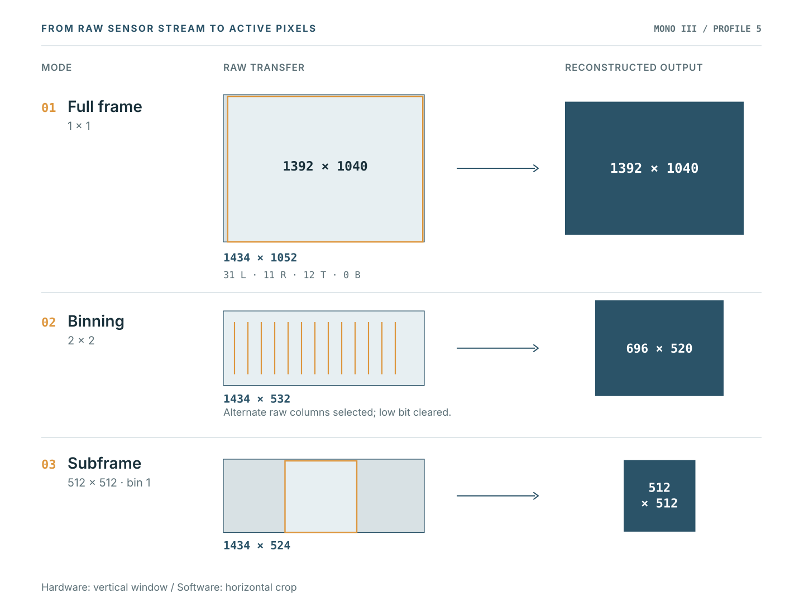
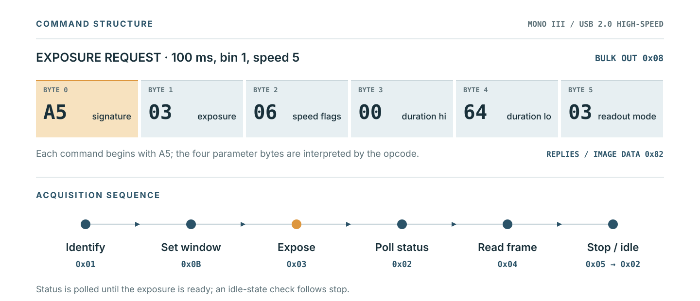

# OpenStarShoot

OpenStarShoot is an open-source Linux driver for the **Orion StarShoot Deep Space Monochrome Imager III (#52076)**. It lets this CCD camera work with **KStars/Ekos** through INDI, and provides a standalone C library, command-line tools and a FITS exporter for direct camera control.

The driver supports full-frame imaging and regions of interest (ROIs) at **1×1 and 2×2 binning**, including binned subframes. It produces unsigned 16-bit FITS images and preserves the original raw camera data.

## Install for KStars/Ekos

These commands are for **Debian 13**, where OpenStarShoot has been built and tested. Other Linux distributions will need the corresponding development packages.

Install the dependencies, then build from the OpenStarShoot source directory:

```sh
sudo apt install build-essential libusb-1.0-0-dev libindi-dev libcfitsio-dev indi-bin python3 kstars
make all indi
```

Install the library, tools and INDI driver:

```sh
sudo make PREFIX=/usr install install-indi
sudo ldconfig
```

The INDI driver is installed as `indi_openstarshoot` with its device definition under `/usr/share/indi`. Restart KStars if it was already running.

### USB permissions

The tested camera identifies as USB **`1856:001e`**. If your Linux account cannot access the device, create a group and udev rule:

```sh
sudo groupadd --system --force openstarshoot
sudo usermod -aG openstarshoot "$USER"
sudo tee /etc/udev/rules.d/70-openstarshoot.rules >/dev/null <<'RULE'
SUBSYSTEM=="usb", ENV{DEVTYPE}=="usb_device", ATTR{idVendor}=="1856", ATTR{idProduct}=="001e", GROUP="openstarshoot", MODE="0660"
RULE
sudo udevadm control --reload-rules
```

Log out and back in, then reconnect the camera. `id -nG` should include `openstarshoot`. If your distribution already grants access to the camera, you can use its existing permissions.

### Connect through Ekos

1. Open KStars and create an Ekos equipment profile.
2. Select **OpenStarShoot Mono III** as the CCD camera, and let Ekos start the local INDI server.
3. Connect the camera and use the Capture module to set the exposure, frame and binning.

New connections start in full-frame 1×1 mode. For 2×2 subframes, use even X/Y coordinates and even width/height in the camera's **1392 × 1040** unbinned sensor area. The delivered image has half the requested width and height.

You can also run the INDI server directly:

```sh
indiserver -v indi_openstarshoot
```

For this arrangement, connect Ekos to the running server (normally port 7624) instead of starting another server for the same camera. Restrict server access to a trusted network.

The camera has no software-operated shutter. Cover it with an opaque cap before acquiring dark frames.

## Use the camera without INDI

The native library and diagnostic tools build independently of INDI:

```sh
sudo apt install build-essential libusb-1.0-0-dev python3
make
sudo make install
sudo ldconfig
```

The native installation uses `/usr/local` by default. You can run the tools from a source build without installation using `./build/starshoot-diag` and `python3 tools/fits_export.py`.

### Capture and export a FITS image

This example captures a 100 ms, 2×2-binned 512 × 512 sensor-space subframe. The resulting FITS image is **256 × 256** pixels.

```sh
ROOT="${XDG_STATE_HOME:-$HOME/.local/state}/openstarshoot-cli"
OUT="$ROOT/$(date -u +%Y%m%dT%H%M%SZ)-$$"
mkdir -p "$ROOT"

starshoot-diag capture "$OUT" --illuminated --exposure-ms 100 \
  --bin 2 --roi 440 264 512 512

starshoot-fits-export "$OUT/light.raw" "$OUT/active.fits" \
  --exposure-ms 100 --image-type LIGHT --trace-dir "$OUT"
```

Leave out `--roi` for the entire sensor, or `--bin 2` for unbinned imaging. Use `starshoot-diag info NEW_DIRECTORY` to read the camera identification and status. For darks, cover the sensor and use `--covered --dark-ms 100`, then export `dark.raw` with `--image-type DARK`.

Each capture uses a new directory. The CLI retains raw images and diagnostic records; it does not overwrite earlier captures. Disconnect the camera from Ekos before running the CLI, since only one program can control it at a time.

Ekos capture records are saved in `${XDG_STATE_HOME:-$HOME/.local/state}/openstarshoot`, unless `OPENSTARSHOOT_RAW_DIRECTORY` is set before starting INDI. These files remain on disk until you remove them.

For capture options and FITS details, see [CLI and FITS export](docs/cli-and-fits.md).

## Imaging modes

OpenStarShoot takes ROI coordinates in unbinned active-sensor pixels, with `(0,0)` at the upper-left of the active array. Both full-frame and ROI acquisition work at either binning setting.



| Mode | Active FITS size |
| --- | --- |
| Full frame, 1×1 | 1392 × 1040 |
| Full frame, 2×2 | 696 × 520 |
| ROI, 1×1 | Requested width × height |
| ROI, 2×2 | Requested width/2 × height/2 |

For bin 2, ROI origin and dimensions must be even. The underlying raw raster includes sensor margins, which the driver removes when building the active image. The original raw file is kept separately.

## Native camera controls

The C library exposes identification, status, exposure, readout, image reconstruction and normal stop. Its [API reference](docs/library-api.md) covers the functions, ROI geometry and build options.

Paired cooler/fan commands are available through the native API and CLI. Their command encoding and replies have passed offline tests; operation on a physical camera has not yet been checked. Cooling and temperature controls are not exposed through INDI.

## Technical documentation

OpenStarShoot communicates through libusb using the camera's original command protocol. The [technical notes](docs/technical-notes.md) describe the six-byte commands, image reconstruction and recorded behaviour.



The project documentation is divided into:

- [CLI capture and FITS export](docs/cli-and-fits.md)
- [Native C library API](docs/library-api.md)
- [USB protocol and image reconstruction](docs/technical-notes.md)

## Validation and limitations

Full-frame 1×1/2×2 and centred/offset 1×1 subframes passed physical native and
KStars/Ekos bench captures, including normal disconnection and reconnection.
Combined 2×2 subframes passed two physical native captures and INDI tests with
synthetic data; that combined mode has not had a separate physical Ekos test.
Exposure timing and optical orientation are not calibrated. Recovery after an
interrupted readout, transport error or physical USB disconnection is unverified.
The nine-pixel zero-run limitation is documented in the technical notes.

## Offline tests

The existing tests use synthetic data and do not require a camera:

```sh
sudo apt install python3-numpy python3-astropy
make all indi check check-fits check-roi check-indi
```

The optional INDI build dependencies above are required for the full suite.
NumPy and Astropy are test dependencies only; the FITS exporter itself uses
Python's standard library.

## Licence

[MIT](LICENSE). Copyright (c) 2026 Prajwal Bhattaram.
