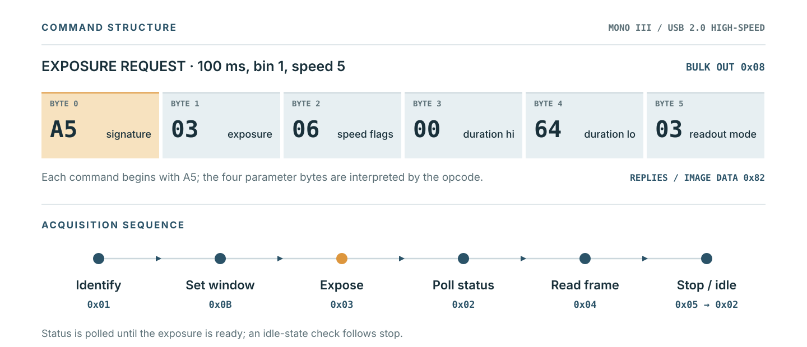
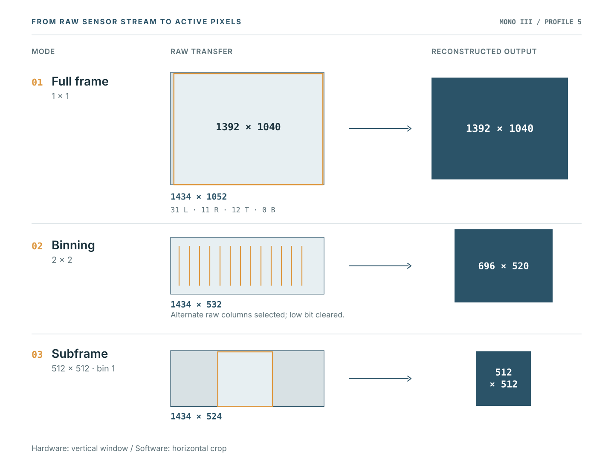
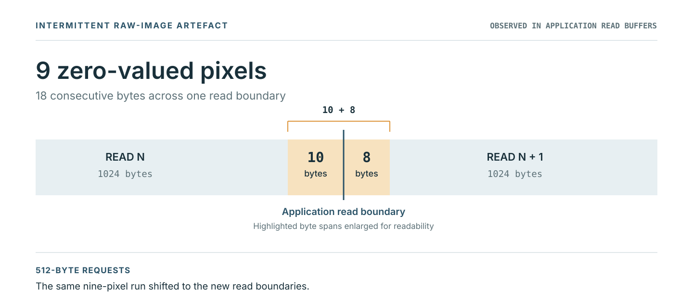

# USB protocol and image reconstruction

OpenStarShoot communicates with the physically tested StarShoot Mono III (USB `1856:001e`, sensor profile 5) over USB 2.0 high-speed. Interface 0 uses bulk endpoint `0x08` for commands and bulk endpoint `0x82` for control replies and image data. The device advertises a 512-byte USB bulk maximum packet size; the application normally requests image data in 1024-byte libusb reads. Those are different quantities.

## Command framing

Commands have six bytes: `A5`, an opcode and four command-specific parameters. Ordinary command replies contain eight bytes. A tested identification exchange is:

```text
OUT  A5 01 00 00 00 00
IN   A5 00 01 00 05 00 00 00
```

The response identifies the profile-5 sensor path. Exposure settings encode a requested duration, readout speed and acquisition mode. For example, a nominal 100 ms, bin-1 exposure at speed 5 uses `A5 03 06 00 64 03`. The same settings at bin 2 use mode byte `07`.



The main commands recovered for this camera are:

| Opcode | Purpose |
| --- | --- |
| `0x01` | Identify camera/profile |
| `0x02` | Query status |
| `0x03` | Configure/start exposure |
| `0x04` | Start image readout |
| `0x05` | Stop acquisition |
| `0x07` | Camera capabilities |
| `0x08` | Offset control |
| `0x09` | Counter |
| `0x0B` | Readout window |
| `0x0C` | Cooler/fan command |

The sequence is: identify and prepare the camera, set the readout window, start exposure, poll status until ready, initiate readout, then stop and check that the camera returns to idle. Firmware reset and factory analogue commands have been identified in the original driver but are not used by OpenStarShoot.

## Sensor geometry

The active image area is **1392 x 1040** pixels. The raw USB data includes rows and columns that are not part of that output image. OpenStarShoot preserves the raw stream and reconstructs the selected region.



The full set of currently supported layouts is:

| Request | Raw raster | Active output |
| --- | --- | --- |
| Full frame, bin 1 | 1434 x 1052 | 1392 x 1040 |
| Full frame, bin 2 | 1434 x 532 | 696 x 520 |
| ROI, bin 1 | 1434 x (height + 12) | width x height |
| ROI, bin 2 | 1434 x (height/2 + 12) | width/2 x height/2 |

All ROI origins and sizes in the public API, CLI and INDI driver are expressed in unbinned active-sensor coordinates. Bin-2 requests need even X, Y, width and height, and use a vertical camera window starting at `Y/2` with `height/2 + 12` raw rows. The camera transfers the full raw row width even for an X-limited ROI.

Bin-1 reconstruction selects the active image beginning at raw row 12 and column `31 + X`. For the full-frame raster, that means 31 columns are discarded on the left, 11 on the right, 12 rows at the top and none at the bottom.

Bin-2 reconstruction begins at raw row 6 and selects alternating raw columns using column `30 + X + 2*outputX`; its low pixel bit is cleared. The output's vertical origin is already accounted for by the device window. The driver therefore does not add Y a second time during reconstruction. This is the camera's native binned readout, rather than software averaging of groups of four pixels.

## FITS values

The FITS exporter represents camera counts as unsigned 16-bit data using `BITPIX=16`, `BSCALE=1` and `BZERO=32768`. Exposure duration, binning and sensor-space ROI origin are included in the headers. The raw image file is kept unchanged. No optical orientation correction, WCS or calibration is applied.

## Known image behaviour

A small number of acquisitions have contained short sequences of zero-valued pixels in the raw stream. The observed pattern has been nine pixels (18 bytes), with ten zero bytes at the end of an application read and eight at the start of the next. The pattern followed the application read boundaries when the requested read size changed. Its precise origin has not been established.



The original Orion documentation also notes that readout artefacts can occur at higher readout speeds, although equivalence with this particular observation has not been established. The driver keeps the recorded values unchanged; the behaviour is documented rather than automatically corrected.

## INDI operating behaviour

The adapter uses readout speed 5 and supplies the normal INDI connection, exposure, frame and binning properties. It does not advertise temperature, cooling, active-abort or fast-sequence controls. It refuses a normal disconnect while acquisition or image upload is in progress. Readout is synchronous and can occupy the event loop for its bounded 30-second deadline. After an acquisition failure, new exposures are blocked within that INDI connection; automatic device resets or speculative recovery are not attempted.
